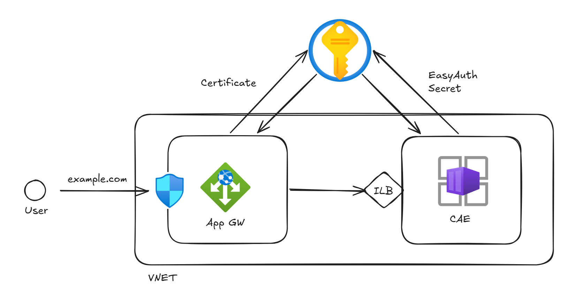

# Container Apps (Easy Auth) with Application Gateway

This Terraform sample deploys an internal Azure Container Apps (ACA) environment behind a public Application Gateway and protects an NGINX app with Microsoft Entra ID authentication (Easy Auth).

It demonstrates how to preserve the public origin during authentication when the gateway and backend use different host names. Similar reverse-proxy considerations apply to App Service, but this template deploys **Container Apps only**.

## Architecture



### Request and sign-in flow

1. Public DNS resolves the custom domain to Application Gateway's static public IP.
2. Application Gateway terminates HTTPS using a certificate referenced from Key Vault.
3. The gateway connects to the app's default ACA FQDN over HTTPS. Private DNS resolves that name to the internal environment IP.
4. The gateway overwrites `X-Forwarded-Host` with the public custom domain and `X-Forwarded-Proto` with `https`.
5. Easy Auth uses those headers to determine the original public URL, redirect users to Microsoft Entra ID, and return them to `https://<custom-domain>/.auth/login/aad/callback`.
6. After successful authentication, requests reach NGINX.

Without the forwarded-origin configuration, redirects and authentication cookies can use the backend host instead of the public host, causing sign-in failures or redirect loops.

### Resources created

- Resource group and VNet (`10.0.0.0/16`).
- Application Gateway subnet (`10.0.0.0/24`), NSG, and subnet association. Custom inbound rules allow HTTPS and Application Gateway v2 management traffic; Azure's default NSG rules remain.
- Standard_v2 Application Gateway with autoscaling from one to two instances and a Standard static public IP.
- ACA subnet (`10.0.1.0/24`) and an internal workload profiles (v2) environment with a Consumption profile.
- NGINX Container App with a user-assigned managed identity and a Key Vault-backed client-secret reference.
- Private DNS zone for the environment's default domain, VNet link, and wildcard/apex A records.
- A record in the existing public DNS zone.
- Single-tenant Entra app registration, service principal, and Easy Auth configuration.
- Gateway managed identity and secret-scoped Key Vault Secrets User role assignments.
- Log Analytics workspace (`appgw-aca-laws`) and environment diagnostic settings, with 30-day log retention.

> **Production considerations:** This sample assumes a publicly reachable Key Vault for simpler setup. For production, use a private endpoint and appropriate private DNS/network configuration for both secret consumers. Those resources are not included here. Also review image version pinning, availability requirements, secret rotation, and whether a WAF-enabled gateway is required; this sample uses Standard_v2, not WAF_v2.

## Prerequisites

- Terraform **1.5.0 or later** and Azure CLI.
- Permissions to create the Azure resources and role assignments, plus permission to create Entra app registrations and service principals.
- An existing Azure Key Vault using **Azure RBAC** authorization.
- An existing custom domain and Azure public DNS zone, already delegated from the domain registrar. The custom domain must equal the zone name or be a subdomain of it.
- A valid gateway TLS certificate covering the custom domain, stored in the configured Key Vault as a certificate-backed secret containing the private key. Use its **secret URI**, not its certificate URI.
- An existing Key Vault secret for the Entra client secret. A temporary placeholder can be used initially because the app registration is created by Terraform. Replace it after deployment as described below.

Use versionless secret URIs, such as `https://<vault-name>.vault.azure.net/secrets/<secret-name>`. Store both secrets in the configured Key Vault so the role assignments apply to the correct vault.

The template creates the NSG; **an existing NSG is not required**. The existing vault, DNS zone, domain, and certificate are not provisioned by this template.

## Configuration

Run the commands below from this directory. Create a local `terraform.tfvars` using values for your environment:

```hcl
resource_group_name               = "appgw-aca-rg"
location                          = "westus"
vnet_name                         = "appgw-aca-vnet"
appgw_network_security_group_name = "appgw-aca-appgw-nsg"
cae_name                          = "cae-appgw-aca"
aca_name                          = "nginx"

# Must exist prior to running Terraform
custom_domain                       = "example.com"
public_dns_zone_name                 = "example.com"
public_dns_zone_resource_group_name  = "dns-rg"
tenant_id                           = "<tenant-id>"

# Must exist prior to running Terraform
key_vault = {
  name                = "<vault-name>"
  resource_group_name = "<vault-resource-group>"
}
key_vault_easyauth_secret_uri           = "https://<vault-name>.vault.azure.net/secrets/entra-client-secret"
key_vault_appgw_certificate_secret_uri  = "https://<vault-name>.vault.azure.net/secrets/appgw-certificate"
```

## Deployment

```powershell
az login --tenant <tenant-id>
az account set --subscription <subscription-id>
$env:ARM_SUBSCRIPTION_ID = az account show --query id --output tsv

terraform init
terraform validate
terraform plan -out=tfplan
terraform apply tfplan
```

### Complete the client-secret setup

Terraform creates the app registration but **does not create its client secret**. This is to keep the secret out of the Terraform state file.

1. Run `terraform output -raw easy_auth_client_id`.
2. In the Entra admin center, find the app registration by that application/client ID.
3. Under **Certificates & secrets**, create a client secret and copy its **Value** immediately. The secret ID is not a usable credential.
4. In Key Vault, add a new version of the secret referenced by `key_vault_easyauth_secret_uri`, containing that value exactly, without extra quotes or whitespace.
5. Allow the versionless Key Vault reference to refresh. If sign-in still uses the previous value, restart the active revision after the update has propagated. You may also need to logout and login again.

## Outputs and verification

Run `terraform output` to see the values defined in [outputs.tf](./outputs.tf).

| Output | Purpose |
| --- | --- |
| `application_url` | Public HTTPS URL to open in a browser. |
| `appgw_public_ip` | Expected public DNS A-record address. |
| `public_dns_name_servers` | Nameservers for checking registrar delegation. |
| `easy_auth_client_id` | App registration to use when creating the client secret. |
| `easy_auth_redirect_uri` | Expected Entra web redirect URI. |
| `aca_fqdn` | Gateway backend host name; not a public bypass URL. |
| `aca_environment_private_ip` | Expected environment private DNS destination. |
| `aca_identity_principal_id` | App identity used to read its client secret. |
| `appgw_identity_principal_id` | Gateway identity used to read its certificate secret. |

Open the application URL in an InPrivate/incognito browser, sign in with an account allowed by the single-tenant registration, and confirm the NGINX welcome page appears. The callback must use the public domain, not the ACA backend domain.

A command-line request without a session or bearer token can receive a `401` challenge instead of a browser redirect. That alone does not demonstrate a broken browser sign-in flow.

## Logs and troubleshooting

In the deployed Log Analytics workspace, use the resource-specific `ContainerAppConsoleLogs` table. Replace the app name if you changed `aca_name`:

```kusto
ContainerAppConsoleLogs
| where TimeGenerated > ago(1h)
| where ContainerAppName == "nginx"
| where ContainerName == "http-auth"
| project TimeGenerated, Log
| order by TimeGenerated desc
| take 50
```

| Symptom | Checks |
| --- | --- |
| `401` after completing sign-in; logs show `AADSTS7000215` / `invalid_client` | Entra rejected the submitted client secret. Verify the secret value belongs to the output client ID, is not expired, and is stored in the correct vault secret. Allow refresh/restart if an older value was cached. |
| Redirect loop or callback using the backend domain | Verify the gateway's forwarded-header rewrite and Easy Auth's custom forward-proxy settings. Check the Entra redirect URI against `easy_auth_redirect_uri`. |
| `502 Bad Gateway` | Check Application Gateway backend health, private DNS resolution, app readiness, and HTTPS backend connectivity. |
| Certificate or Key Vault access errors | Verify Azure RBAC mode, the identity's secret-scoped role assignment, the certificate secret URI, certificate validity, and vault network access. |
| Public domain fails to resolve | Check registrar delegation and the A record against `appgw_public_ip`. |

The gateway health probe intentionally accepts `200-499`, including authentication challenges. A healthy backend therefore does **not** prove that an interactive login succeeds.